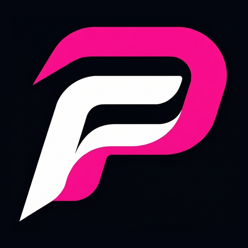

<p align="center"></p>

# PhootFlow

Programa de escritorio para Windows que edita **sola** una sesión de fotos entera (500, 1000, 2000 fotos):
corrige exposición, limpia el grano, endereza, propone el mejor recorte, aparta las fallidas, aplica el estilo
del tipo de evento (o **tu propio estilo aprendido**) y exporta en JPG, con versión en blanco y negro editorial
opcional. Antes se llamaba *EventEdits*.

## Instalar

| Opción | Cuándo |
|---|---|
| **`instalar.ps1`** (recomendada) | Cualquier PC con Python 3.11+. Imprescindible si Windows tiene **Smart App Control** activo: bloquea el `.exe` sin firmar. |
| **`PhootFlow.exe`** de la [última versión](https://github.com/davidcaptart-glitch/phootflow-desktop/releases/latest) | PCs sin Smart App Control. Al no estar firmado, Windows avisa la primera vez: *Más información → Ejecutar de todas formas*. |

```
powershell -ExecutionPolicy Bypass -File instalar.ps1
```

Las dos se **actualizan solas**: al abrirse (y cada 4 horas) miran si hay una versión nueva, la descargan,
comprueban su SHA-256 y se reinician.

## Uso

1. **Carpeta de la sesión** (los RAW `.ARW`, `.CR3`, `.NEF`, `.RAF`, `.DNG`… o JPG).
2. **Tipo de sesión**: *Automático* lo detecta (boda, cumpleaños/fiesta, discoteca/noche, deporte, retrato,
   exterior) por EXIF y contenido; o elígelo tú, o elige uno de **tus estilos aprendidos**.
3. **Procesar todo**: analiza, selecciona y exporta sin parar. El PC no se suspende mientras trabaja. Si se
   corta, vuelve a pulsarlo: recupera el análisis y no repite lo ya exportado.
   O, si prefieres revisar: **Analizar** → revisa en la rejilla → **Exportar**.

En la rejilla: clic para ver la foto en grande con el recorte marcado; **P** conservar, **X** descartar,
**espacio** alternar. En el panel derecho se cambian exposición, giro y formato de cada foto.

### Qué genera

```
Sesión/
├── Descartadas/            originales apartados (nunca se borran)
├── DSC0001.xmp             (opcional) ajustes para Lightroom, solo si no existía ya uno
└── Editadas/
    ├── Sugeridas/          cada foto en su formato sugerido
    ├── Formatos/4x5/ …     los demás formatos que marques
    ├── ByN/                (opcional) blanco y negro editorial
    ├── Originales.zip      originales conservados, sin pérdida
    ├── informe.csv         estado, motivo, ajustes y avisos de cada foto
    └── .phootflow/         análisis guardado para reanudar (se puede borrar)
```

## Estilos

- **Presets por tipo de evento**: Boda (luminoso, suave, cálido), Cumpleaños/fiesta, Discoteca/noche (más
  limpieza de grano, negros densos, conserva el color de los focos), Deporte (contraste y nitidez),
  Retrato/estudio y Exterior/paisaje.
- **Aprender mi estilo…**: elige una carpeta con tus fotos **ya editadas** de un tipo de evento y PhootFlow
  aprende tu aspecto final (luces, contraste, color, saturación, cuánto B/N usas y tus formatos de recorte).
  Si además le das la carpeta de **originales** con los mismos nombres de archivo, aprende cuánto transformas
  cada foto: más fiel. Los estilos se guardan en `%APPDATA%\PhootFlow\estilos\`.
- **Blanco y negro editorial** (opción): mezcla de canales pensada para la piel, contraste local, negros densos
  sin empastar, blancos limpios y grano fino.

## Selección automática

- Desenfocadas o movidas (relativo a la nitidez media de la sesión).
- Exposición irrecuperable (más de un 30 % quemado o más de 7,5 pasos de subida).
- Casi duplicadas: de cada ráfaga se queda la más nítida.
- **Avisos** (no descartan): ojos quizá cerrados, cara menos nítida que el fondo.

Las caras se detectan con **YuNet** (OpenCV Zoo, licencia MIT), mucho más fiable que Haar con ISO alto y luz
de discoteca.

## Nube

- **Google Drive**: sube `Editadas` a la carpeta que indiques, crea el enlace «cualquiera con el enlace» y lo
  copia al portapapeles. El ZIP de originales va a una carpeta aparte que no se comparte.
- **Carpeta sincronizada**: copia a una carpeta que otra app sube sola (vía para **Amazon Photos**, que no
  tiene API pública).

### Conectar Google Drive (una sola vez)

1. En <https://console.cloud.google.com/> crea un proyecto y activa **Google Drive API**.
2. *Pantalla de consentimiento de OAuth* → **Externo** → añade tu cuenta como usuario de prueba → **Publicar
   aplicación** (si queda «en pruebas», Google caduca el permiso cada 7 días).
3. *Credenciales → ID de cliente de OAuth →* **App de escritorio** → descarga el JSON.
4. En PhootFlow: Nube → **Google Drive** → **Conectar Google Drive…** → elige ese JSON y autoriza.

## Publicar una versión

```
git tag v0.3.0
git push origin v0.3.0
```

GitHub Actions pasa las pruebas, compila `PhootFlow.exe`, comprueba que arranca y procesa, empaqueta
`PhootFlow-src.zip` y lo publica todo con sus SHA-256. Las copias instaladas se actualizan solas.

## Desarrollo

```
pip install -r requirements.txt
python app.py
python app.py --selftest
python -m unittest discover -s tests
```
